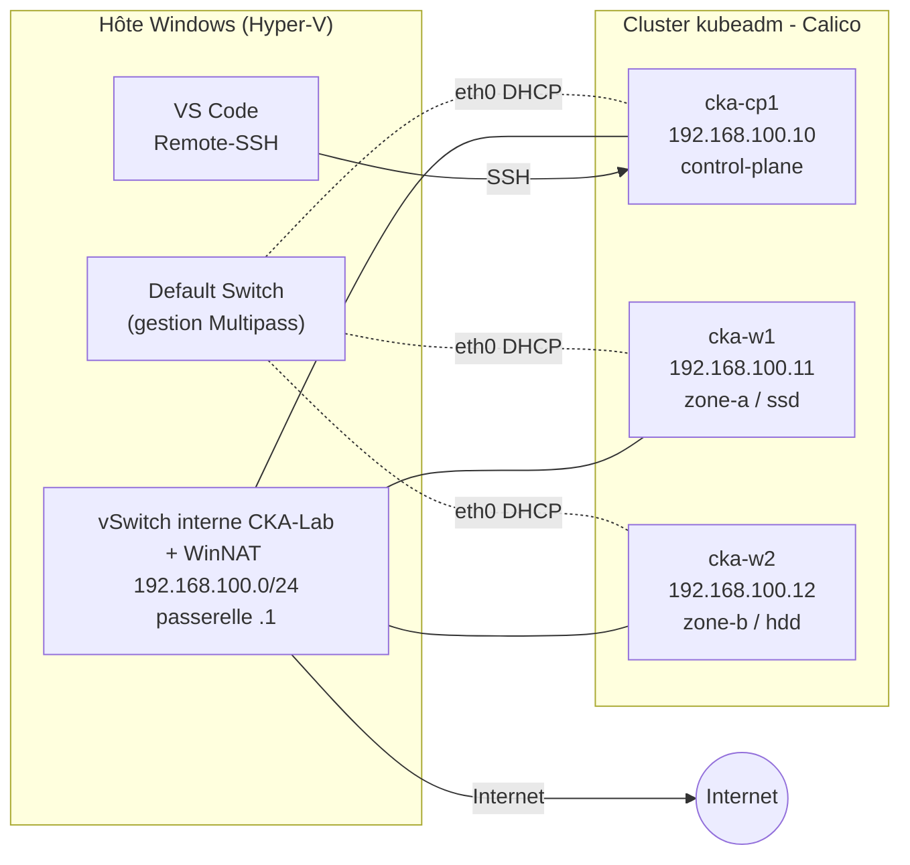
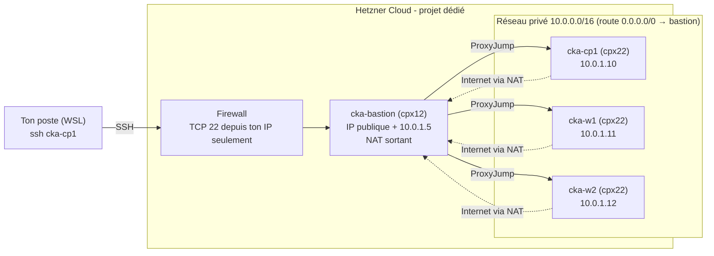

# Prepa-CKA

Deux labs reproductibles pour préparer la certification **CKA (Certified Kubernetes Administrator)**, au choix :

| | **Lab Hyper-V** (`hyperv/`) | **Lab Hetzner** (`hetzner/`) |
|---|---|---|
| Où | sur ton PC Windows (Hyper-V + Multipass) | Hetzner Cloud (Allemagne/Finlande) |
| Pilotage | `hyperv\cka-lab.ps1` (PowerShell admin) | `hetzner/cka-hetzner.sh` (Linux/WSL) + Terraform |
| Cycle de vie | persistant, redémarre avec le PC, snapshots | **éphémère** : créé puis détruit à chaque session |
| Coût | gratuit (≈10 Go de RAM sur l'hôte) | ≈0,14 €/h TTC, facturé tant qu'il existe |
| Accès | `ssh cka-cp1` | `ssh cka-cp1` (via un bastion, comme à l'examen) |

Les deux labs sont **identiques côté Kubernetes** : mêmes noms de nœuds (`cka-cp1`, `cka-w1`, `cka-w2`), mêmes versions, mêmes scripts d'installation, même charge réaliste. Un exercice fait sur l'un se refait à l'identique sur l'autre.

> Objectif : s'entraîner dans des conditions proches de l'examen (kubeadm, Ubuntu, SSH vers les nœuds, `kubectl`/`vim` en terminal), pouvoir tout casser, et revenir à un état propre en une commande.

---

## Sommaire

- [Versions : une seule source](#versions--une-seule-source)
- [Organisation du dépôt](#organisation-du-dépôt)
- [Lab Hyper-V](#lab-hyper-v)
- [Lab Hetzner](#lab-hetzner)
- [Charge réaliste : `cka-seed.sh`](#charge-réaliste--cka-seedsh)
- [Utilisation au quotidien](#utilisation-au-quotidien)
- [Sécurité](#sécurité)
- [Dépannage](#dépannage)
- [Limites connues](#limites-connues)

---

## Versions : une seule source

Toutes les versions sont dans **`common/versions.env`**, lu par les deux labs (PowerShell, Terraform et scripts bash) :

| Élément | Version | Remarque |
|---|---|---|
| Ubuntu | 24.04 | image Multipass / image Hetzner `ubuntu-24.04` |
| Kubernetes | **1.36.6** (kubeadm, kubelet, kubectl figés au patch près) | l'examen est en **v1.37** : on garde une mineure de retard pour s'entraîner à l'upgrade |
| Calico | v3.33.0 | testé par Tigera avec Kubernetes 1.35 à 1.37 |
| Helm | v3.22.1 | binaire officiel, somme de contrôle vérifiée |
| containerd | paquet Ubuntu 24.04 | même dépôt pour les deux labs |
| Composants du seed | voir le fichier | local-path, metrics-server, Gateway API, Traefik, podinfo |

Pour changer une version : modifier `common/versions.env`, puis recréer le lab. Chaque lab vérifie l'écart entre le fichier et ce qui tourne :

```bash
ssh cka-cp1 bash /opt/cka/show-versions.sh     # appelé aussi par Status (Hyper-V) et status (Hetzner)
```

Après un exercice d'upgrade, un écart sur `kubelet`/`kube-apiserver` est normal.

---

## Organisation du dépôt

```
Prepa-CKA/                      (D:\cka sous Windows)
├── common/                     PARTAGÉ par les deux labs
│   ├── versions.env            source unique des versions
│   ├── bootstrap-node.sh       préparation d'un nœud : noyau, containerd, paquets Kubernetes, kubelet
│   ├── init-cp.sh              kubeadm init + Calico + Helm (idempotent étape par étape)
│   ├── show-versions.sh        contrôle des versions déployées
│   └── cka-seed.sh             charge réaliste
├── hyperv/
│   └── cka-lab.ps1             provisioning Hyper-V/Multipass
├── hetzner/
│   ├── *.tf                    infrastructure (réseau, firewall, bastion, nœuds)
│   ├── templates/              cloud-init du bastion et des nœuds, durcissement SSH
│   ├── cka-hetzner.sh          orchestration (create, seed, status, destroy…)
│   ├── terraform.tfvars.example
│   └── .terraform.lock.hcl     versions exactes des providers (versionné)
├── .githooks/pre-commit        blocage local des secrets
└── .vscode/settings.json       KUBECONFIG du terminal intégré (lab Hyper-V)
```

Les scripts de `common/` sont déposés dans **`/opt/cka`** sur chaque nœud par le cloud-init de chaque plateforme (encodés en base64). Seule la partie réseau est propre à chaque plateforme.

Fichiers générés, **jamais versionnés** : `ssh/`, `kube/`, `cloud-init/`, `logs/`, `runtime/` (Hyper-V), `hetzner/ssh/`, `hetzner/.terraform/`, `*.tfstate`.

---

## Lab Hyper-V

### Architecture



| Nœud | IP fixe | vCPU | RAM | Disque | Rôle |
|---|---|---|---|---|---|
| `cka-cp1` | 192.168.100.10 | 2 | 4 Go | 30 Go | control-plane |
| `cka-w1` | 192.168.100.11 | 2 | 3 Go | 25 Go | worker |
| `cka-w2` | 192.168.100.12 | 2 | 3 Go | 25 Go | worker |

- **Deux interfaces par nœud.** Multipass garde toujours une interface sur le *Default Switch*, dont le sous-réseau change à chaque redémarrage. Kubernetes est donc lié à une seconde interface, sur un vSwitch interne + NAT dédié, avec IP fixes (`--node-ip`, `--apiserver-advertise-address`, autodétection Calico par CIDR).
- **Persistance.** Les VM démarrent avec l'hôte, et une tâche planifiée vérifie le vSwitch, le NAT et l'état des VM à chaque démarrage. Elle exécute une copie du script dans `runtime\`, indépendante de la branche Git courante.

### Prérequis

| Élément | Détail |
|---|---|
| OS | Windows 10/11 **Pro ou Entreprise** (Hyper-V indisponible sur l'édition Famille) |
| Hyper-V | `Enable-WindowsOptionalFeature -Online -FeatureName Microsoft-Hyper-V -All` puis redémarrage |
| Multipass | `winget install Canonical.Multipass`, puis `multipass set local.driver=hyperv` |
| Git | `winget install --id Git.Git -e` |
| VS Code | avec l'extension `ms-vscode-remote.remote-ssh` |
| Client OpenSSH | présent par défaut sur Windows 10/11 |
| Ressources | 16 Go de RAM minimum (le lab en consomme environ 10), ~90 Go libres sur le disque cible |

### Démarrage rapide

**1. Cloner le dépôt** (PowerShell **non admin**, dossier cible vide ou inexistant) :

```powershell
git clone https://github.com/YannOps/Prepa-CKA.git D:\cka
cd D:\cka
git config core.hooksPath .githooks
```

**2. Créer le lab** (PowerShell **admin**, 20 à 30 minutes) :

```powershell
Set-ExecutionPolicy -Scope Process Bypass
.\hyperv\cka-lab.ps1 -Action Create
```

**3. Peupler le cluster** (charge réaliste + snapshot `seeded`) :

```powershell
.\hyperv\cka-lab.ps1 -Action Seed
```

**4. Vérifier :**

```powershell
.\hyperv\cka-lab.ps1 -Action Status
```

La colonne `INTERNAL-IP` doit afficher des adresses en `192.168.100.x`, et le contrôle des versions doit être `OK` partout.

### Migration depuis l'ancienne organisation (script à la racine)

Si ton lab a été créé avec `D:\cka\cka-lab.ps1` (avant la réorganisation) :

1. `git pull`, puis en PowerShell admin : `.\hyperv\cka-lab.ps1 -Action RegisterTask`. **Indispensable** : la tâche de démarrage pointait vers `D:\cka\cka-lab.ps1`, qui n'existe plus.
2. Ton cluster existant reste en v1.34 : soit tu t'entraînes à l'upgrader, soit `Destroy` puis `Create` pour repartir en 1.36.

### Référence du script `hyperv\cka-lab.ps1`

| Action | Effet |
|---|---|
| `Create` | crée le réseau, les VM et le cluster, configure l'accès depuis l'hôte, prend le snapshot `clean` (idempotent) |
| `Seed` | exécute `common/cka-seed.sh` sur cka-cp1 puis prend le snapshot `seeded` |
| `Status` | état des VM, du NAT, des nœuds et contrôle des versions |
| `Snapshot` | arrête le lab, prend un snapshot des 3 nœuds, redémarre |
| `Restore` | restaure un snapshot sur les 3 nœuds |
| `Repair` | vérifie le vSwitch et le NAT, démarre les VM arrêtées (appelée au démarrage par la tâche planifiée) |
| `RegisterTask` | (ré)enregistre la tâche planifiée de démarrage |
| `Destroy` | supprime le lab (VM, réseau, tâche, entrées hosts et SSH) ; conserve le script, la clé SSH et le stockage Multipass |
| `ResetStorage` | ramène le stockage Multipass à son emplacement par défaut (aucune instance ne doit exister) |

| Paramètre | Défaut | Rôle |
|---|---|---|
| `-SwitchName` | `CKA-Lab` | nom du vSwitch Hyper-V |
| `-NetPrefix` | `192.168.100` | préfixe du réseau du lab (/24) |
| `-LabRoot` | `D:\cka` | dossier des fichiers générés du lab (racine du dépôt) |
| `-MultipassStorage` | `D:\multipass` | stockage Multipass, **commun à toutes les instances Multipass de l'hôte** |
| `-SnapshotName` | `clean` (`seeded` pour `Seed`) | nom du snapshot pour `Snapshot`, `Restore` et `Seed` |
| `-NoSnapshot` | — | ne pas prendre le snapshot `clean` à la fin de `Create` |

Les versions ne sont plus des paramètres : elles viennent de `common/versions.env`.

> Si tu changes `-LabRoot`, `-NetPrefix` ou `-SwitchName`, passe la même valeur à **toutes** les actions suivantes.

---

## Lab Hetzner

### Architecture



- **Un seul point d'entrée.** Les nœuds n'ont **aucune IP publique**. Le bastion est le seul serveur joignable, en SSH, depuis ton IP uniquement. Il joue le rôle de la machine de départ de l'examen.
- **Sortie Internet des nœuds** : une route du réseau Hetzner envoie `0.0.0.0/0` vers le bastion, qui fait le NAT (nftables). Les nœuds utilisent les résolveurs DNS de Hetzner.
- **Même expérience que sur Hyper-V** : `ssh cka-cp1` depuis WSL passe par le bastion grâce à `ProxyJump`, configuré automatiquement.
- **Nœuds répartis** sur des hôtes physiques différents (placement group *spread*, gratuit).

### Coût

Prix Hetzner de novembre 2026 (HT, Allemagne/Finlande) : cpx12 ≈ 0,019 €/h, cpx22 ≈ 0,032 €/h. Le lab complet revient donc à environ **0,115 €/h HT (≈0,14 € TTC)**, soit **environ 0,55 € TTC pour une session de 4 heures**. Le script affiche l'estimation exacte avant de créer quoi que ce soit.

Un serveur **éteint reste facturé** : seul `destroy` arrête la facturation. Laissé allumé, le lab coûterait environ 86 € TTC par mois (plafond mensuel Hetzner).

### Prérequis

- Linux ou WSL avec `terraform` (≥ 1.5), `ssh`, `curl`, `jq`.
- Un compte Hetzner Cloud, et **un projet dédié** au lab (ex. `cka-lab`).
- Un jeton API **Lecture/Écriture** créé dans ce projet (*Security → API tokens*).

### Démarrage rapide

```bash
cd ~/Prepa-CKA
git config core.hooksPath .githooks
read -rs HCLOUD_TOKEN && export HCLOUD_TOKEN      # colle le jeton (rien ne s'affiche)

./hetzner/cka-hetzner.sh create      # ~10 à 15 min : disponibilité, coût, Terraform, kubeadm
./hetzner/cka-hetzner.sh seed        # charge réaliste
ssh cka-cp1                          # au travail
./hetzner/cka-hetzner.sh destroy     # FIN DE SESSION : plus rien n'est facturé
```

### Référence du script `hetzner/cka-hetzner.sh`

| Action | Effet |
|---|---|
| `create` | vérifie le jeton et la disponibilité des types de serveurs, affiche le coût horaire, crée l'infrastructure (Terraform), attend cloud-init, lance `kubeadm init` + Calico + Helm, joint les workers, configure SSH |
| `seed` | copie et exécute `common/cka-seed.sh` sur cka-cp1 |
| `status` | serveurs du lab facturés en ce moment, nœuds Kubernetes, contrôle des versions |
| `update-ip` | met à jour ton IP publique dans le firewall (après un changement d'IP de ta box) |
| `ssh-config` | régénère `hetzner/ssh/config` et l'`Include` en tête de `~/.ssh/config` |
| `destroy` | supprime tout, nettoie la config SSH et vérifie qu'aucun serveur `lab=cka` ne subsiste |

`-y` après `create` ou `destroy` supprime la confirmation.

| Variable d'environnement | Défaut | Rôle |
|---|---|---|
| `HCLOUD_TOKEN` | — (obligatoire) | jeton API, lu directement par le provider Terraform |
| `CKA_LOCATION` | `fsn1` | emplacement (`fsn1`, `nbg1`, `hel1`) |
| `CKA_NODE_TYPE` | `cpx22` | type des 3 nœuds Kubernetes |
| `CKA_BASTION_TYPE` | `cpx12` | type du bastion |
| `CKA_ADMIN_CIDR` | ton IP détectée, en /32 | adresse autorisée en SSH |

**Disponibilité** : Hetzner affiche régulièrement des types « indisponibles » selon l'emplacement. `create` le vérifie avant de lancer Terraform et indique les emplacements possibles. Exemple : `CKA_LOCATION=hel1 ./hetzner/cka-hetzner.sh create`.

**Revenir à un état propre** : le lab étant éphémère, `destroy` puis `create` + `seed` (environ 20 minutes). Il n'y a pas de snapshot côté Hetzner : ils seraient facturés au Go stocké.

**Accès HTTP aux NodePorts** (30080) : depuis le bastion (`ssh cka-bastion curl -H 'Host: shop.local' http://10.0.1.11:30080/`), ou par tunnel `ssh -L 8080:10.0.1.11:30080 cka-bastion`.

---

## Charge réaliste : `cka-seed.sh`

Script idempotent, exécuté sur `cka-cp1` (`-Action Seed` ou `cka-hetzner.sh seed`), qui transforme le cluster vierge en environnement proche de ceux de l'examen. Il n'introduit **aucune panne**.

**Composants additionnels** (versions dans `common/versions.env`)

| Composant | Usage |
|---|---|
| local-path-provisioner | StorageClass `local-path` par défaut |
| metrics-server | `kubectl top`, HPA |
| Gateway API (canal standard) | CRDs Gateway, HTTPRoute, ReferenceGrant… |
| Traefik (chart Helm) | IngressClass `traefik` + GatewayClass/Gateway, NodePort 30080/30443 |
| podinfo (chart Helm) | service `api` |

**Contenu par namespace**

| Namespace | Contenu | Thèmes CKA |
|---|---|---|
| `frontend` | nginx ×3, ConfigMap, probes, HPA, PDB, répartition sur les zones, Ingress, HTTPRoute | workloads, réseau, Gateway API |
| `backend` | api (Helm), redis, worker avec init container et PriorityClass, ReferenceGrant | Helm, configuration, accès entre namespaces |
| `data` | PostgreSQL en StatefulSet avec PVC dynamique, NetworkPolicies, ressources personnalisées `Backup` | stockage, NetworkPolicy, CRD |
| `monitoring` | DaemonSet sur tous les nœuds (toleration, hostPath), ClusterRole | scheduling, RBAC |
| `batch` | CronJob, Job | workloads |
| `team-a` | ResourceQuota, LimitRange, RBAC (utilisateur, ServiceAccount), sidecar, PV statique | quotas, RBAC, stockage manuel |

Les manifests appliqués sont conservés dans `~/manifests/seed` sur `cka-cp1`, et un exemple Kustomize (non appliqué) dans `~/manifests/kustomize`.

**Tests rapides** (depuis un nœud ; sur Hetzner, IP en `10.0.1.x`)

```bash
curl -H 'Host: shop.local'        http://192.168.100.11:30080/      # Gateway API -> frontend
curl -H 'Host: shop.local'        http://192.168.100.11:30080/api   # Gateway API -> backend (ReferenceGrant)
curl -H 'Host: legacy.shop.local' http://192.168.100.11:30080/      # Ingress -> frontend
kubectl top nodes
kubectl get bk -A
```

---

## Utilisation au quotidien

| Méthode | Hyper-V | Hetzner |
|---|---|---|
| SSH (conditions d'examen) | `ssh cka-cp1`, puis `sudo -i` si besoin | identique (via le bastion) |
| VS Code | F1 → *Remote-SSH: Connect to Host* → `cka-cp1` | identique, depuis VS Code lancé dans WSL |
| kubectl depuis l'hôte | ouvrir `D:\cka` dans VS Code (`KUBECONFIG` préconfiguré) | non : kubectl sur `cka-cp1`, comme à l'examen |
| Secours | `multipass shell cka-cp1` | console web Hetzner |

**Déjà configuré sur les nœuds :** alias `k` et autocomplétion bash, `vim`, `jq`, `crictl`, `etcdctl` (paquet `etcd-client`). **Sur `cka-cp1` :** `kubectl` et `helm`.

**Volontairement non configuré :** les raccourcis personnels (`$do`, `$now`, `.vimrc`), à retaper au début de chaque session comme le jour de l'examen :

```bash
export do="--dry-run=client -o yaml"
export now="--force --grace-period=0"
echo 'set tabstop=2 shiftwidth=2 expandtab' >> ~/.vimrc
```

**Cycle d'entraînement (Hyper-V)**

```powershell
.\hyperv\cka-lab.ps1 -Action Restore -SnapshotName seeded             # repartir d'un état propre
.\hyperv\cka-lab.ps1 -Action Snapshot -SnapshotName avant-upgrade     # avant un exercice risqué
```

---

## Sécurité

**Commun**

- **Aucun secret versionné.** Clés SSH, kubeconfig, cloud-init générés, state Terraform et `.tfvars` sont exclus par `.gitignore`. Un nouveau poste produit ses propres secrets.
- **Hook `pre-commit`** : il bloque l'ajout de fichiers sensibles (`ssh/`, `kube/`, `runtime/`, `.terraform/`, `*.tfstate`, `*.tfvars`, clés, `.pem`…) et de contenus de type clé privée, certificat kubeconfig ou jeton Hetzner. Il s'active avec `git config core.hooksPath .githooks`, **à refaire après chaque clone** (y compris dans WSL).
- **Dépôt public** : la protection de GitHub contre l'envoi de secrets ne détecte que les formats connus. Le `.gitignore` et le hook restent la protection principale.
- **Portée du lab** : `metrics-server` utilise `--kubelet-insecure-tls` et les Secrets du seed contiennent des valeurs fictives. Acceptable pour un lab isolé, pas pour un environnement réel.
- **En cas de fuite** : invalider d'abord le secret (clé SSH à régénérer, `Destroy`/`destroy` puis recréation pour les certificats, **jeton Hetzner à révoquer dans la console**), puis nettoyer l'historique Git. Supprimer le fichier dans un nouveau commit ne suffit pas.

**Hyper-V** : `ssh\` et `kube\` sont restreints (droits NTFS) à l'utilisateur courant, SYSTEM et Administrateurs, condition exigée par OpenSSH pour Windows.

**Hetzner**

| Sujet | Mesure |
|---|---|
| Jeton API | projet dédié ; jeton uniquement dans la variable d'environnement `HCLOUD_TOKEN`. Aucune variable Terraform ne le reçoit : il ne peut finir ni dans un fichier, ni dans le state. Le script le transmet à `curl` par descripteur de fichier, jamais en argument visible dans la liste des processus |
| Exposition | seul le bastion a une IP publique (IPv6 désactivée) ; firewall Hetzner : TCP 22 depuis ton IP uniquement (`0.0.0.0/0` refusé par Terraform) |
| Réseau privé | **non filtré par les firewalls Hetzner** (limite documentée par Hetzner) et non chiffré, mais isolé par projet. D'où l'absence d'IP publique sur les nœuds |
| SSH | clé ed25519 propre au lab (`hetzner/ssh/`, droits 600), clé uniquement, `PermitRootLogin no`, `AllowUsers ubuntu`, `MaxAuthTries 3`, pas de redirection d'agent ni X11 |
| Bastion | fail2ban sur SSH, mises à jour de sécurité automatiques, NAT limité au sens réseau privé → Internet |
| Cluster | pas de cloud-controller-manager ni de driver CSI Hetzner : aucun jeton API dans le cluster |
| Clés d'hôte | `known_hosts` propre au lab, remis à zéro à chaque `create` |

---

## Dépannage

**Hyper-V**

| Symptôme | Cause | Solution |
|---|---|---|
| `New-NetNat … Windows System Error 52` | un autre NAT, parfois invisible, utilise déjà le préfixe | `Get-NetNat` ; supprimer le NAT en conflit, redémarrer Windows, ou relancer avec `-NetPrefix 192.168.150` |
| `NAT '…' (hors lab CKA) couvre deja …` | un NAT d'un autre environnement utilise le même réseau | le supprimer s'il ne sert plus, sinon changer `-NetPrefix` |
| `cannot connect to the multipass socket` | service Multipass arrêté | `Start-Service Multipass` (le script le fait automatiquement) |
| `Hash of … does not match` au lancement | image en cache corrompue | arrêter le service, supprimer `…\cache\vault\images\noble-*`, `multipass find --force-update` |
| `detected dubious ownership` (Git) | fichiers créés par une session admin | `git config --global --add safe.directory D:/cka` |
| `Fichier de versions introuvable` | script copié hors du dépôt | lancer `hyperv\cka-lab.ps1` depuis le dépôt (il lit `..\common`) |
| Le lab ne se répare plus au démarrage | tâche planifiée pointant vers l'ancien emplacement du script | `.\hyperv\cka-lab.ps1 -Action RegisterTask` |
| `INTERNAL-IP` d'un nœud hors `192.168.100.x` | le nœud a pris l'IP de l'interface du Default Switch | vérifier `/etc/default/kubelet` (`--node-ip`) sur le nœud |

Journal de la tâche de démarrage : `D:\cka\logs\repair.log`.

**Hetzner**

| Symptôme | Cause | Solution |
|---|---|---|
| `non commandable a fsn1 actuellement` | type de serveur épuisé à cet emplacement | `CKA_LOCATION=nbg1` ou `hel1`, ou un autre type (`CKA_NODE_TYPE=…`) |
| `Jeton refuse par l'API Hetzner` | jeton invalide, révoqué ou en lecture seule | recréer un jeton Lecture/Écriture dans le projet du lab |
| `cka-bastion injoignable en SSH` | ton IP publique a changé | `./hetzner/cka-hetzner.sh update-ip` |
| `cloud-init en erreur sur cka-…` / `pkgs.k8s.io injoignable` | sortie Internet du nœud (route, NAT du bastion, DNS) | `ssh cka-w1 sudo tail -50 /var/log/cloud-init-output.log` ; sur le bastion : `sudo nft list ruleset` |
| `REMOTE HOST IDENTIFICATION HAS CHANGED` | lab recréé hors du script | `./hetzner/cka-hetzner.sh ssh-config` après avoir vidé `hetzner/ssh/known_hosts` |

**Commun**

| Symptôme | Cause | Solution |
|---|---|---|
| Script bash en échec (`\r: command not found`) | fins de ligne Windows | `.gitattributes` force LF sur `*.sh` et `*.env` ; re-cloner si besoin |
| `ImagePullBackOff` avec `toomanyrequests` | limite de téléchargement de Docker Hub sans authentification | attendre puis relancer le seed |
| `show-versions.sh` signale un `ECART` | version modifiée à la main, ou exercice d'upgrade | normal après un upgrade ; sinon recréer le lab |

---

## Limites connues

- **Hyper-V** : Hyper-V n'autorise en pratique qu'un NAT par réseau, et le stockage Multipass est global à l'hôte (il n'est déplacé que si aucune instance Multipass n'existe).
- **Hetzner** : le bastion est un point unique (accès et sortie Internet), ce qui est acceptable pour un lab. Pas de snapshot : revenir à un état propre veut dire recréer le lab (environ 20 minutes).
- **containerd** vient des dépôts Ubuntu : les deux labs ont la même version s'ils sont créés à la même période, mais elle suit les mises à jour d'Ubuntu.
- Le contenu exact des clusters d'examen n'est pas public : le seed reflète le programme officiel et les retours de candidats, pas une copie de l'examen.

---

## Références

- [Programme officiel CKA - Linux Foundation](https://training.linuxfoundation.org/certification/certified-kubernetes-administrator-cka/)
- [Installation de kubeadm](https://kubernetes.io/docs/setup/production-environment/tools/kubeadm/install-kubeadm/)
- [Calico : prérequis et versions testées](https://docs.tigera.io/calico/latest/getting-started/kubernetes/requirements)
- [Multipass : IP statiques](https://documentation.ubuntu.com/multipass/latest/how-to-guides/manage-instances/configure-static-ips/)
- [Hyper-V : réseau NAT](https://learn.microsoft.com/windows-server/virtualization/hyper-v/setup-nat-network)
- [Hetzner : FAQ des firewalls](https://docs.hetzner.com/cloud/firewalls/faq/)
- [Hetzner : réseau privé avec passerelle NAT](https://community.hetzner.com/tutorials/private-network-nat-lb-hetzner-opentofu/)
- [Provider Terraform hcloud](https://registry.terraform.io/providers/hetznercloud/hcloud/latest/docs)
- [Gateway API](https://gateway-api.sigs.k8s.io/)
